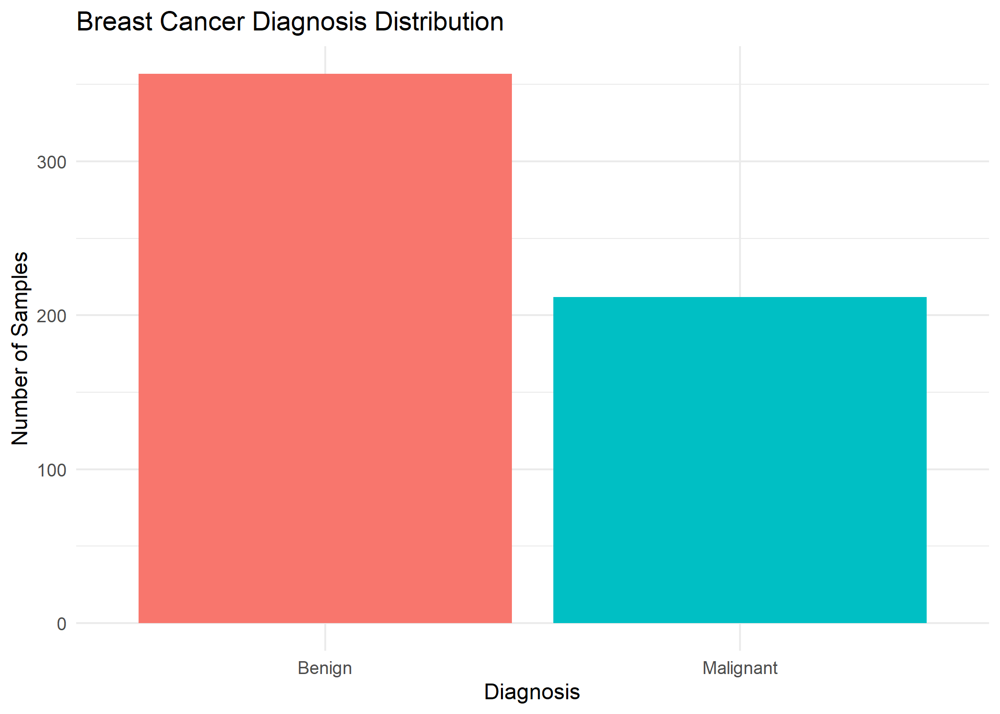
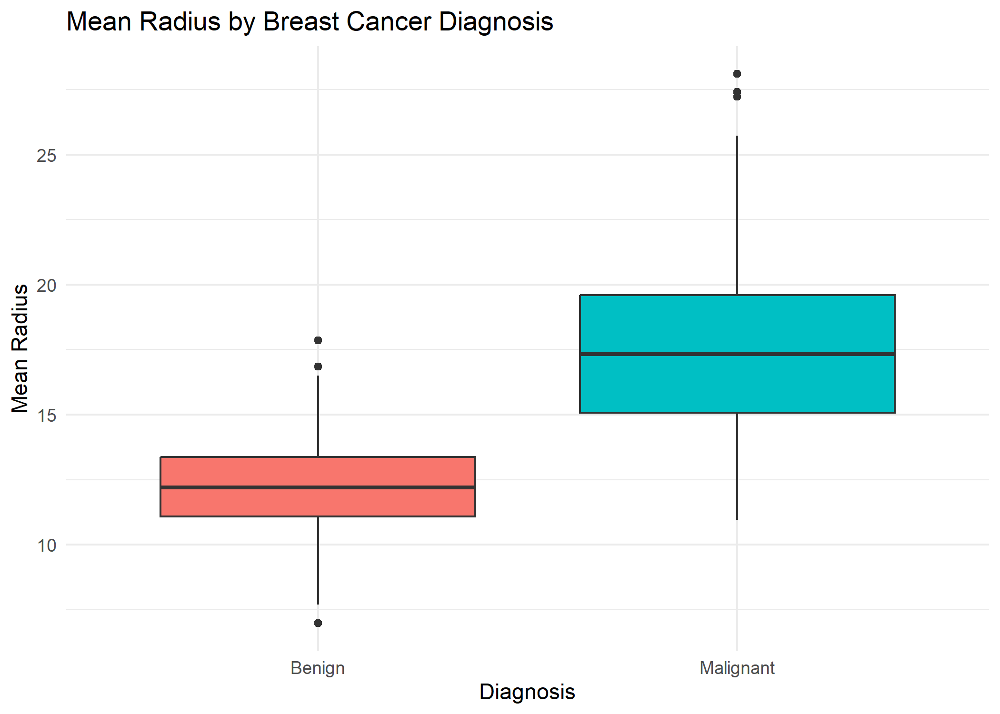
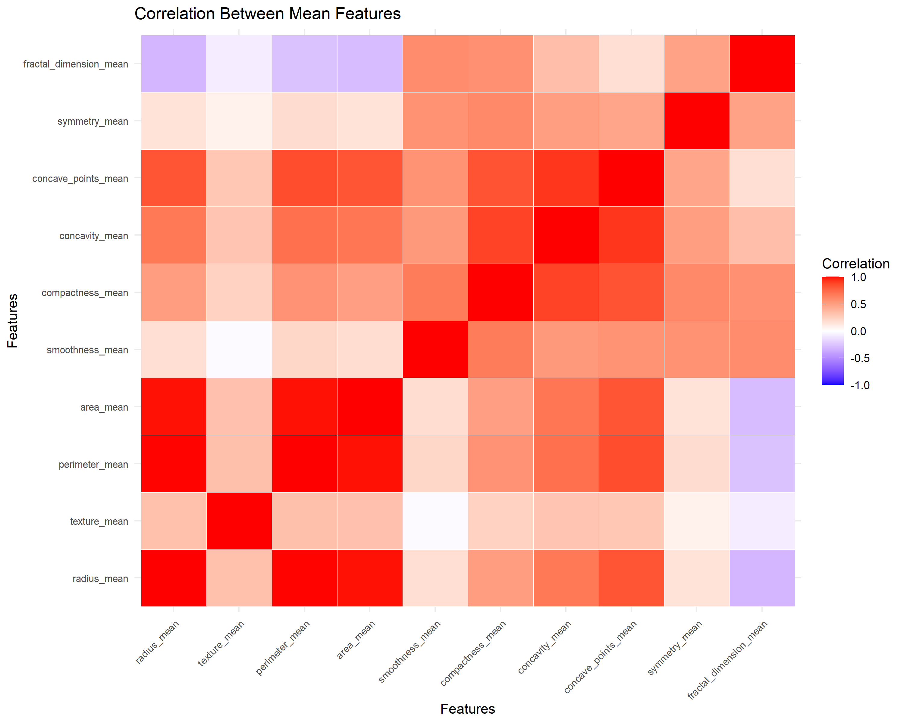
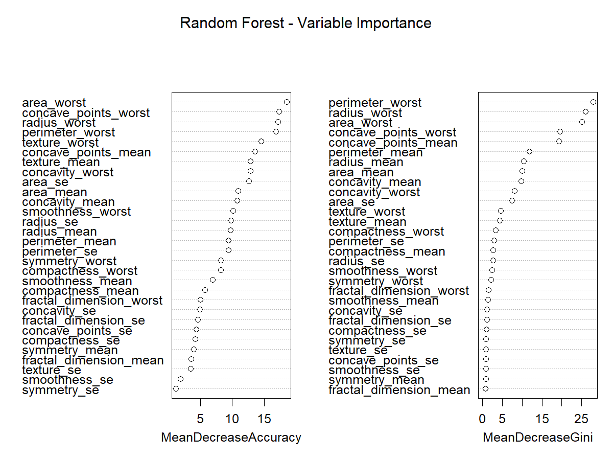

# Breast Cancer Classification Using Machine Learning in R

**Bioinformatics – ICA 03**  
**Student ID:** 2021ASP59  
**Programming Language:** R

---

## 1. Introduction

Breast cancer is one of the most common types of cancer affecting women worldwide. Early and accurate identification of breast cancer is important for supporting timely medical diagnosis and treatment.

Machine Learning techniques can help analyse medical datasets, identify patterns, and classify diseases based on relevant features.

This project, **Breast Cancer Classification Using Machine Learning in R**, focuses on developing a machine learning classification model to distinguish between benign and malignant breast tumours using the Wisconsin Diagnostic Breast Cancer (WDBC) dataset.

The project involves data preprocessing, Exploratory Data Analysis (EDA), data visualization, model training, prediction, and performance evaluation using the Random Forest algorithm.

The main goal is to explore how machine learning can be applied to biological and medical data for breast cancer classification.

## 2. Project Objectives

The main objectives of this project are:

- To understand and analyse a breast cancer diagnostic dataset.
- To perform data cleaning and preprocessing.
- To explore the dataset using statistical analysis and visualization techniques.
- To identify patterns and relationships between tumour measurements.
- To develop a Random Forest classification model.
- To predict whether a tumour is benign or malignant.
- To evaluate the model using appropriate classification metrics.
- To identify important features that influence model predictions.

## 3. Dataset Description

This project uses the **Wisconsin Diagnostic Breast Cancer (WDBC)** dataset, which is available through the UCI Machine Learning Repository.

The dataset contains measurements computed from digitized images of fine needle aspirate (FNA) samples of breast masses.

### Dataset Information

| Description | Details |
|---|---|
| Dataset Name | Wisconsin Diagnostic Breast Cancer (WDBC) |
| Total Records | 569 |
| Total Columns | 32 |
| Target Variable | Diagnosis |
| Classification Type | Binary Classification |
| Classes | Benign (B), Malignant (M) |

### Diagnosis Distribution

| Diagnosis | Number of Records |
|---|---:|
| Benign | 357 |
| Malignant | 212 |
| **Total** | **569** |

### Features

The dataset contains 30 numerical features describing different characteristics of cell nuclei.

These measurements include:

- Radius
- Texture
- Perimeter
- Area
- Smoothness
- Compactness
- Concavity
- Concave Points
- Symmetry
- Fractal Dimension

Each feature is represented using three measurement types:

- **Mean:** Average value of the measurement.
- **SE (Standard Error):** Standard error of the measurement.
- **Worst:** The largest or most extreme measurement values.

The diagnosis column is used as the target variable for classification.

## 4. Technologies and Tools Used

The following technologies and tools were used:

| Technology / Tool | Purpose |
|---|---|
| R Programming Language | Data analysis and model development |
| RStudio | Development environment |
| Random Forest | Machine learning classification |
| ggplot2 | Data visualization |
| corrplot | Correlation visualization |
| Git | Version control |
| GitHub | Source code hosting and project management |

## 5. Project Methodology

The project follows a systematic machine learning workflow.

### Step 1: Data Import

The original WDBC dataset was imported into the R environment for further processing.

### Step 2: Data Cleaning and Preprocessing

The following preprocessing activities were performed:

- Assigned appropriate column names to the dataset.
- Converted the diagnosis column into a categorical factor.
- Checked the dataset structure and dimensions.
- Checked for missing values.
- Prepared and saved the cleaned dataset for further analysis.

### Step 3: Exploratory Data Analysis (EDA)

Exploratory Data Analysis was performed to understand the distribution of diagnosis classes and relationships between tumour measurements.

### Step 4: Data Visualization

Different visualization techniques were used to identify patterns and understand the dataset.

### Step 5: Model Training

A Random Forest classification model was trained using the prepared dataset.

### Step 6: Prediction

The trained model was used to predict the diagnosis of unseen test records.

### Step 7: Model Evaluation

The model performance was evaluated using a confusion matrix, accuracy, sensitivity, and specificity.

### Step 8: Feature Importance Analysis

Feature importance analysis was performed to identify the measurements that contributed to the classification model.

## 6. Exploratory Data Analysis and Visualizations

Several visualizations were created to understand the dataset and explore the differences between benign and malignant tumours.

### 6.1 Diagnosis Distribution

This bar chart shows the number of benign and malignant cases in the dataset.



**Observation:** The dataset contains 357 benign cases and 212 malignant cases.

### 6.2 Tumour Radius Distribution

The boxplot compares the mean radius measurements of benign and malignant tumours.



**Observation:** The distribution of tumour radius values differs between benign and malignant cases.

### 6.3 Correlation Heatmap

The correlation heatmap visualizes relationships between numerical tumour measurement features.



**Observation:** The heatmap helps identify relationships between tumour characteristics and understand how different measurements are associated.

### 6.4 Random Forest Feature Importance

The feature importance plot shows the relative importance of input features used by the Random Forest classification model.



**Observation:** This visualization helps identify which tumour measurements contribute more to the model's classification decisions.

## 7. Machine Learning Model

### Random Forest Classification

Random Forest was selected as the machine learning algorithm for this project.

Random Forest is an ensemble learning algorithm that combines multiple decision trees to produce a final prediction. For classification, the trees collectively determine the predicted class.

### Model Configuration

| Parameter | Value |
|---|---|
| Algorithm | Random Forest |
| Number of Trees | 500 |
| Target Variable | Diagnosis |
| Classification Classes | Benign and Malignant |
| Training Data | 80% |
| Testing Data | 20% |
| Random Seed | 123 |

A stratified train-test split was used to maintain the class distribution in both training and testing datasets.

The model was trained using the training dataset and evaluated using the separate testing dataset.

## 8. Model Performance Evaluation

The trained Random Forest model was evaluated using the following classification metrics:

| Evaluation Metric | Result |
|---|---:|
| Accuracy | 98.26% |
| Sensitivity | 100% |
| Specificity | 97.22% |

### Understanding the Evaluation Metrics

**Accuracy:** Measures the percentage of total predictions that were correctly classified.

**Sensitivity:** Measures how effectively the model identifies actual malignant cases.

**Specificity:** Measures how effectively the model identifies actual benign cases.

### Results

The model achieved an accuracy of 98.26%, with 100% sensitivity and 97.22% specificity on the test dataset.

These results indicate that the Random Forest model performed well in distinguishing between benign and malignant cases in the evaluated dataset.

## 9. Project Structure

The repository is organized into the following directories:

```text
2021ASP59/
│
├── code/
│   ├── 01_data_import_cleaning.R
│   ├── 02_exploratory_data_analysis.R
│   └── 03_model_training_evaluation.R
│
├── data/
│   ├── raw/
│   └── processed/
│
├── figures/
│   ├── 01_diagnosis_distribution.png
│   ├── 02_radius_boxplot.png
│   ├── 03_correlation_heatmap.png
│   └── 04_variable_importance.png
│
├── output/
│
├── .gitignore
├── 2021ASP59.Rproj
└── README.md
```

## 10. How to Run the Project

Follow these steps to run the project locally.

### Prerequisites

- R Programming Language
- RStudio
- Required R packages

### Step 1: Clone the Repository

```bash
git clone https://github.com/AmashaBandara/2021ASP59.git
```

### Step 2: Open the Project

Open the `2021ASP59.Rproj` file using RStudio.

### Step 3: Install Required Packages

Run the following commands in the R console:

```r
install.packages("ggplot2")
install.packages("randomForest")
install.packages("corrplot")
```

### Step 4: Execute the R Scripts

Run the scripts in the following order:

1. `01_data_import_cleaning.R`
2. `02_exploratory_data_analysis.R`
3. `03_model_training_evaluation.R`

Make sure the original dataset is available in the expected `data/raw/` directory before running the first script.

## 11. Limitations and Future Improvements

Although the model achieved good classification performance, the project has some limitations.

### Limitations

- The model was developed using a single diagnostic dataset.
- The results may vary when using different datasets.
- The model has not been validated for real-world clinical use.
- Further testing is required before considering practical medical applications.

### Future Improvements

- Evaluate additional machine learning algorithms.
- Compare the performance of different classification models.
- Perform further feature selection and optimization.
- Test the model using additional breast cancer datasets.
- Develop a user-friendly interface for making predictions.

## 12. Conclusion

This project demonstrates how machine learning techniques can be applied to biological and medical data for breast cancer classification.

Using the Wisconsin Diagnostic Breast Cancer dataset, a Random Forest classification model was developed in R to distinguish between benign and malignant tumours.

The model achieved **98.26% accuracy, 100% sensitivity, and 97.22% specificity** on the test dataset.

The project provided practical experience in data preprocessing, exploratory data analysis, data visualization, machine learning model development, and performance evaluation using R.

This project is an academic machine learning exercise and is not intended to replace professional medical diagnosis.

---

## 13. Repository Information

**Project Name:** Breast Cancer Classification Using Machine Learning in R

**Module:** Bioinformatics – ICA 03

**Student ID:** 2021ASP59

**GitHub Repository:** [AmashaBandara/2021ASP59](https://github.com/AmashaBandara/2021ASP59)

**Programming Language:** R

